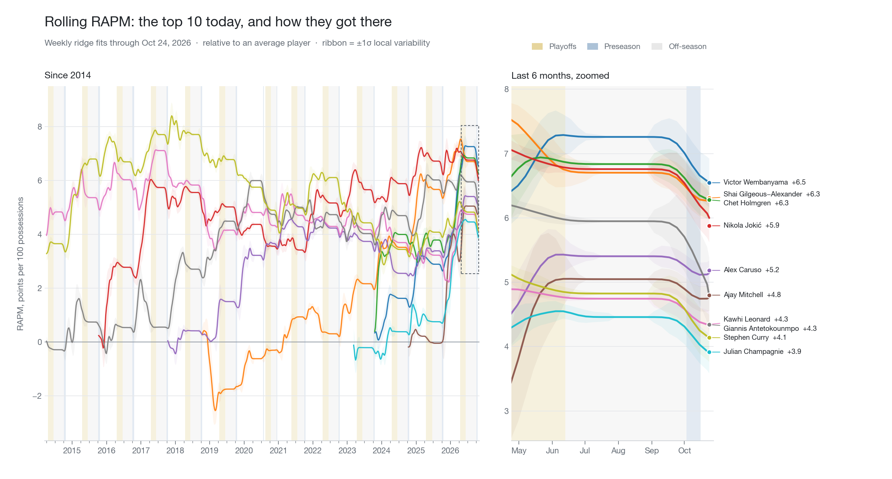

<p align="center">
  
</p>

<h1 align="center">deep-rapm</h1>
<p align="center"><b>Who is actually helping their team win, right now?</b><br>
Regularized Adjusted Plus-Minus over 2.2 million NBA possessions,<br>
refit every week of basketball since 2018 in under a minute.</p>

<p align="center">
  <a href="https://pypi.org/project/deep-rapm/"></a>
  
  
  
</p>

<p align="center">
  <a href="#the-idea-in-thirty-seconds"><b>The idea</b></a> &nbsp;·&nbsp;
  <a href="#the-trick-incremental-gram-updates"><b>The trick</b></a> &nbsp;·&nbsp;
  <a href="#quickstart"><b>Quickstart</b></a> &nbsp;·&nbsp;
  <a href="#the-data-pipeline"><b>The data</b></a> &nbsp;·&nbsp;
  <a href="#the-model"><b>The model</b></a>
</p>

*The chart above: nine seasons of rolling RAPM for the current top 20, one ridge fit per week. Gold bands are playoffs, blue bands are preseason (weighted at 0.20), grey bands are the off-season — including the thin blue sliver in July 2020, which is the COVID bubble scrimmages.*

---

## The idea in thirty seconds

Plus-minus tells you what happened while a player was on the floor — and credits him for everything his four teammates did. RAPM fixes that with a regression: every possession is a row, the ten players on the court are the columns, and ridge regression untangles who was responsible for the points. The result is each player's offensive and defensive impact **per 100 possessions, controlling for the other nine players**.

`deep-rapm` does this at three speeds:

- **One season, one number** — `solve-rapm`, an exact weighted ridge solve.
- **A date range** — fetch, cache, and fit any window of games.
- **Every week since 2018** — `rolling-rapm`, which refits the entire league at 396 evaluation dates in under a minute, using the incremental update below.

Possessions are weighted by three things at once: **recency** (exponential decay, one-year half-life), **competitiveness** (garbage time at a 24-point lead counts ~5%), and **context** (preseason possessions enter at 0.20 weight — enough to steady October estimates, too little to let camp scrimmages move a star's rank).

```
pip install "deep-rapm[viz]"
```

## Current leaderboard

<!-- leaderboard:start -->
<!-- leaderboard:end -->

## The trick: incremental Gram updates

Refitting ridge regression from scratch at every evaluation date means rebuilding $X^\top W X$ from the full possession history — $O(n \cdot P^2)$ per date, with $n$ in the millions. The weights make that unnecessary.

Each possession $i$ carries weight

$$w_i(t) = 0.5^{\Delta_i / H} \cdot \exp\!\left(-d_i^2 / \sigma^2\right) \cdot c_i$$

where $\Delta_i$ is the possession's age in days at evaluation date $t$, $H$ the recency half-life, $d_i$ the score differential when the possession started ($\sigma$ calibrated so a 95th-percentile blowout gets weight 0.05), and $c_i$ a context weight (1.0 for regular season and playoffs, 0.20 for preseason).

Only the recency factor depends on $t$ — and it depends on it the **same way for every possession**. Advance the evaluation date by $\Delta$ days and every existing weight decays by the same scalar $\gamma = 0.5^{\Delta/H}$. So the sufficient statistics decay by $\gamma$ too, and new game-dates just add on:

$$G(t+\Delta) = \gamma \, G(t) + X_{\text{new}}^\top W_{\text{new}} X_{\text{new}}, \qquad b(t+\Delta) = \gamma \, b(t) + X_{\text{new}}^\top W_{\text{new}}\, y_{\text{new}}$$

`IncrementalGramState` holds $G$, $b$, and the intercept accumulators as running state; each weekly step costs $O(k \cdot P^2)$ for the $k$ possessions of the newly ingested dates — roughly **650× fewer floating-point operations** than a rebuild, with numerically identical results (validated against the full recompute via `--no-incremental`).

<details>
<summary><b>The full solve at each date</b></summary>

With state $G = X^\top W X$, $\;b_y = X^\top W y$, $\;b_1 = X^\top W \mathbf{1}$:

$$\hat{\mu} = \frac{\sum_i w_i y_i}{\sum_i w_i}, \qquad \hat{\beta} = (G + \alpha I)^{-1}\left(b_y - \hat{\mu}\, b_1\right)$$

The intercept is the weighted mean of the response and is not penalized; the response is centered, the columns of $X$ are not — the standard RAPM approximation, negligible under strong ridge regularization. Coefficients split into offense and defense blocks, $\beta = [\theta^{\text{off}}, \theta^{\text{def}}]$, and are reported per 100 possessions:

$$\text{ORAPM}_j = 100\,\theta^{\text{off}}_j, \qquad \text{DRAPM}_j = -100\,\theta^{\text{def}}_j$$

(the sign flip makes "higher = better defense"). Players need 100 possessions in a role to appear in the output at a given date.

</details>

## Quickstart

```bash
pip install "deep-rapm[viz]"

# Rolling RAPM: fit every week since 2018, cache the results, draw the chart
rolling-rapm --include-playoffs --include-preseason \
  --cache rolling_cache.parquet --output rolling_rapm.png \
  --step-days 7 --half-life 365 --top 20

# One-shot RAPM over chosen seasons
solve-rapm --seasons 2024-25 2025-26 --alpha 2000

# Or any date window, fetched and cached on demand
solve-rapm --from-date 2026-10-01 --to-date 2026-11-15 --half-life 180
```

> [!TIP]
> `--cache` **loads** the cache if the file exists — it does not extend it. To pick up new games, move the cache file aside and rerun.

The same things from Python:

```python
from pathlib import Path
from deep_rapm import fit_rolling_rapm

df = fit_rolling_rapm(
    data_dir=Path("data"),
    seasons=["2024-25", "2025-26", "2026-27"],
    step_days=7, half_life_days=365, alpha=2000,
    include_playoffs=True, include_preseason=True,
)
# columns: date, player_id, player_name, orapm, drapm, rapm, n_off, n_def
latest = df[df["date"] == df["date"].max()]
print(latest.nlargest(10, "rapm")[["player_name", "orapm", "drapm", "rapm"]])
```

<details>
<summary><b>Key parameters</b></summary>

| Parameter | Default | Description |
|-----------|---------|-------------|
| `alpha` | 2000 | Ridge penalty — higher shrinks estimates toward zero |
| `half_life_days` | 365 | Recency-weighting half-life in days (`None` = equal weights in one-shot mode) |
| `step_days` | 7 | Days between rolling evaluation dates |
| `warmup_days` | 180 | Skip the first N days (too little data for stable estimates) |
| `min_poss` | 100 | Minimum possessions per role to be reported |
| `include_playoffs` | False | Include playoff possessions at full weight |
| `include_preseason` | False | Include preseason possessions at `preseason_weight` |
| `preseason_weight` | 0.20 | Context weight multiplier for preseason possessions |

</details>

## The data pipeline

Everything comes from public NBA sources and lands in per-season parquet files — one row per possession, with the ten players on court, the points scored, and the score differential when the possession began.

| Source | Role |
|---|---|
| `pbpstats` (enhanced play-by-play via `data.nba.com`) | Primary per-game possession extraction |
| `nba_api` `PlayByPlayV3` + `BoxScoreTraditionalV3` | Automatic fallback when pbpstats returns nothing (recent seasons, Akamai blocks); score-delta point counting, ~97% accuracy vs. final box scores |
| `nba_api` `LeagueGameLog` / `LeagueGameFinder` | Season schedules and nightly game discovery |
| `nba_api` `CommonTeamRoster` / `CommonPlayerInfo` | Player names, positions, and the 1,457-player vocabulary |

```bash
collect-possessions --season 2024-25        # one season, cached per game
collect-players --seasons 2024-25 2025-26   # player vocab + position table
python scripts/collect_nightly.py           # cron target: yesterday's games → season parquets
```

Collection is **idempotent**: each game is written once to `data/games/`, and the nightly merge appends only game IDs the season parquets don't already have. Current coverage: nine seasons, 2018-19 through 2026-27 — regular season, playoffs (play-in included), and 658 preseason games back to 2018.

## The model

A possession is a row of $X \in \mathbb{R}^{n \times 2P}$ with exactly ten ones: five in the offense block, five in the defense block. The outcome is the points scored on the possession,

$$y = \mu \mathbf{1} + X\beta + \varepsilon,$$

fit by weighted ridge regression as described above. The ridge penalty is what makes this *adjusted*: teammates who always play together are statistically inseparable, and $\alpha$ resolves that collinearity by shrinking toward zero rather than exploding in opposite directions.

| Component | Role |
|-----------|------|
| Offense coefficients $\theta^{\text{off}}$ | Points a player adds per offensive possession |
| Defense coefficients $\theta^{\text{def}}$ | Points a player allows per defensive possession (reported negated) |
| Ridge penalty $\alpha$ | Stabilizes estimates under lineup collinearity |
| Weights $w_i$ | Recency × competitiveness × context |

## What is in this repository

| Path | What |
|---|---|
| `deep_rapm/rolling.py` | `IncrementalGramState` and `fit_rolling_rapm` — the incremental solver |
| `deep_rapm/rapm.py` | Design-matrix construction, recency/competition weights, the exact ridge solve |
| `deep_rapm/data/` | Possession extraction (pbpstats + nba_api fallback), season collection, player metadata |
| `rolling_rapm.py` | CLI driver and the chart at the top of this page (`rolling-rapm` is the packaged equivalent) |
| `scripts/collect_nightly.py` | Nightly cron entry: new games → per-game cache → season parquets |
| `docs/incremental_rapm.md` | Derivation notes for the incremental update |
| `tests/` | Possession-extraction, solver, and incremental-vs-full equivalence tests |

## License

MIT — see [LICENSE](LICENSE).
